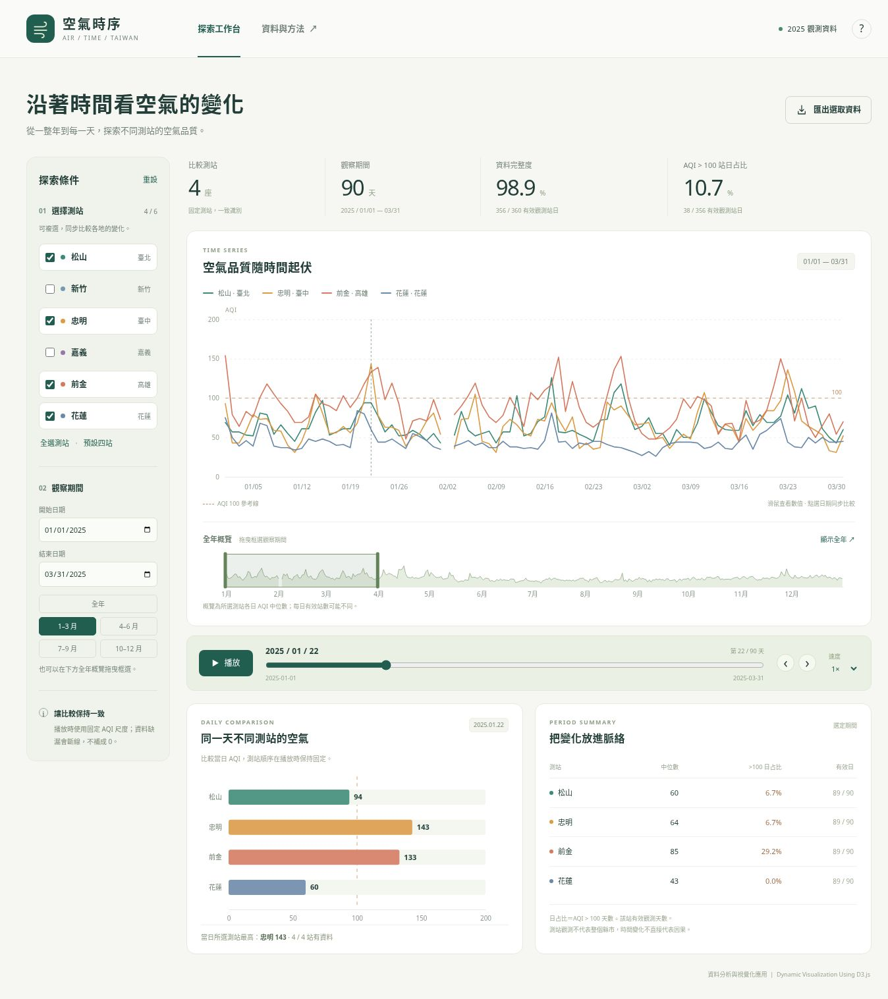
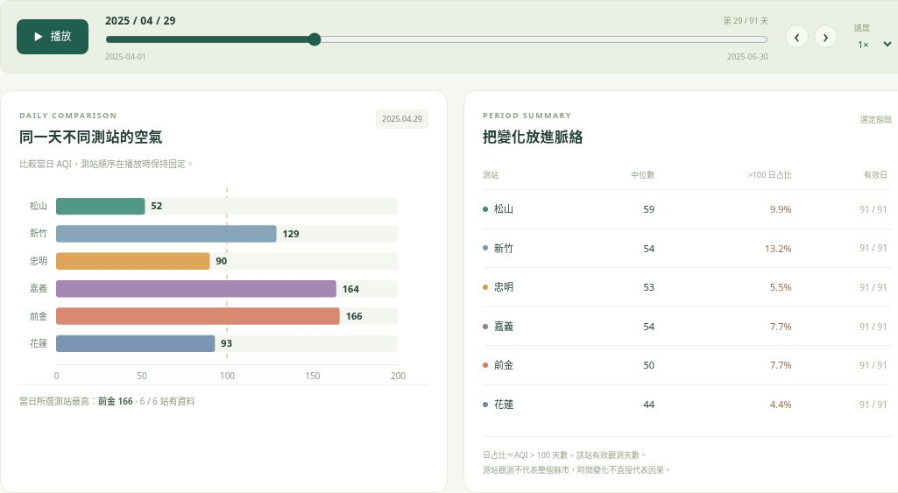

# 台灣 AQI 動態視覺化

**空氣時序 | 2025年六測站的時間探索**

**GitHub 專案：** [https://github.com/fju-csie-vis/1151VIS-HW2-414085105-YinSiaoChen](https://github.com/fju-csie-vis/1151VIS-HW2-414085105-YinSiaoChen)

**線上展示：** [https://fju-csie-vis.github.io/1151VIS-HW2-414085105-YinSiaoChen/](https://fju-csie-vis.github.io/1151VIS-HW2-414085105-YinSiaoChen/)

本報告以環境部 2025 年六個一般測站的官方日 AQI 為資料，實作可播放與篩選的 D3.js 視覺化。多測站折線圖、全年概覽、當日長條圖與期間統計表共用同一份資料，讓使用者從全年趨勢縮小到特定期間，再比較同一天的測站差異。

分析聚焦三個問題：同一天各站的 AQI 差多少？高峰出現在何時、是否共同變化？切換觀察期間後，中位數與 AQI > 100 日占比如何改變？



## 1. 資料範圍與處理流程

### 1.1. 資料來源與觀測單位

日 AQI 採用環境部 AQX_P_434 的 2025 年 12 份月資料；測站名稱、縣市、類型與空品區以 AQX_P_07 核對。本報告使用線上展示的資料快照，下載時間為 2026 年 11 月 12 日 00:59（臺灣時間）。

選取六個空品區各一座一般測站，以涵蓋不同地理位置並保留足夠的年度資料。每筆記錄代表「一個測站的一天」，不是縣市平均值；這六站亦不為全臺代表性抽樣。

| ID | 測站 | 縣市 | 空品區 | 有效日/全年 |
| --- | --- | --- | --- | --- |
| 15 | 松山 | 臺北市 | 北部 | 364/365 |
| 24 | 新竹 | 新竹市 | 竹苗 | 364/365 |
| 31 | 忠明 | 臺中市 | 中部 | 364/365 |
| 42 | 嘉義 | 嘉義市 | 雲嘉南 | 364/365 |
| 56 | 前金 | 高雄市 | 高屏 | 364/365 |
| 63 | 花蓮 | 花蓮縣 | 花東 | 364/365 |

清理後 CSV 的欄位為 date、siteId、siteName、aqi，分別表示日期、測站編號、名稱與官方日 AQI。AQI 為無單位指標，不與 PM2.5 濃度混用，也不自行平均小時 AQI。

### 1.2. 從官方來源建立完整日曆

六站在 2025 年 2 月 2 日均無來源記錄。本報告保留這個缺口，不補零、不插值，也不推測缺漏原因。日期以 UTC 日界儲存與計算，顯示原始日曆日期，避免瀏覽器時區造成日期偏移。

1. 讀取原始 ZIP 與月 CSV，驗證來源檔 SHA-256 及官方各 CSV 的 MD5，保存下載請求、時間與校驗資訊。

2. 篩選 2025 年及六個測站，檢查站名與「測站 ID ＋ 日期」唯一性。相同鍵且同值可除去重複；同鍵異值則停止處理。

3. 空白、無法解析、非有限數與負值標記視為缺失。建立 6 站 × 365 日的日曆網格，補足來源缺列，AQI 保留空值。

4. 輸出 2,190 筆記錄，其中 2,184 筆有效、6 筆缺失；同時產生 metadata 與前端資料封裝，讓繪圖、統計及匯出使用一致內容。

### 1.3. 統計定義與比較分母

| 指標 | 計算方式 |
| --- | --- |
| 單站中位數與日占比 | 中位數只使用該站有效 AQI；大於 100 日占比 ＝ 超過 100 的日數 ÷ 該站有效日數。 |
| 跨站摘要與完整度 | 大於 100 站日占比以所有選定測站的有效站日為分母；完整度＝有效站日 ÷（測站數 × 期間天數）。 |
| 全年概覽與全缺值期間 | 概覽為各日所選測站有效 AQI 的中位數，並非官方區域 AQI。沒有有效值時，中位數與占比顯示「—」。 |

## 2. 視覺化設計與動態實作

視圖分工對應不同分析尺度：折線圖保留時間趨勢，當日長條圖提供同日比較，全年概覽控制觀察區間，統計表則補充可核對的數值。使用者在一個視圖改變條件後，其餘視圖依相同狀態更新。

| 視圖 | 視覺編碼與分析用途 | 主要 D3 實作 |
| --- | --- | --- |
| 多測站折線圖 | X 軸為日期、Y 軸為 AQI、顏色為測站；比較趨勢與高峰。 | scaleUtc、scaleLinear、line、axis |
| 全年概覽 | 輪廓為每日中位數，選區為觀察期間；保留全年脈絡。 | area、brushX |
| 當日長條圖 | 長度為當日 AQI，固定站序與配色；觀察逐日變化。 | scaleBand、data/join、transition |
| 期間統計表 | 顯示中位數、大於 100 日占比與有效日；呈現比較分母。 | 資料計算後以 data/join 更新列 |

### 2.1. 固定尺度與缺值表達

折線與長條共用 0–200 的 AQI 尺度。上限由整份快照最大值向上取 50 的倍數，因此不會隨日期播放縮放；虛線標示 AQI 100。顏色只辨識測站，沒有套用官方 AQI 等級配色；長條也不隨數值重新排序，便於追蹤同一測站。

折線使用 d3.line().defined() 排除缺值，保留日曆上的斷點；單日範圍改以點呈現有效值。若期間完全沒有有效資料，顯示空狀態，而非一條落在零點的線。

### 2.2. 狀態管理與資料綁定

app.js 集中保存 selected、start、end、current、playing 與 speed，分別對應測站、期間、目前日期、播放狀態與速度。setSelected()、setRange() 先暫停播放，再呼叫 renderAll()；逐日播放則由 renderCurrent() 更新日期、滑桿、游標與當日長條，避免重繪整段趨勢。圖形以 .data(chosen, d => d.id).join() 維持測站 ID 與元素的對應。資料改變時，D3 處理新增、更新與移除；長條寬度使用下列動畫邏輯。

```javascript
bars.interrupt();
const target = animate && !reducedMotion.matches
  ? bars.transition().duration(Math.min(250, state.speed * .65))
      .ease(d3.easeCubicOut) : bars;
target.attr('width', d => Number.isFinite(d.aqi)
  ? Math.max(0, x(d.aqi) - m.left) : 0);
```

interrupt() 避免前後動畫堆疊；若使用者啟用「減少動態效果」，長條直接更新。0.5×、1×、2× 分別以 1,200、600、300 毫秒推進一天；到期間末日停止，再次播放時回到區間起點。

### 2.3. 框選與操作替代方式

d3.brushX() 將拖曳位置轉為日期並對齊日曆日，再更新期間；同步旗標避免程式移動選區時重複觸發事件。日期欄位、季度按鈕、滑桿及前後日按鈕提供替代操作；ResizeObserver 於容器變寬或變窄時重算圖表座標。

## 3. 系統操作與展示情境

操作從「選測站與期間」開始，再以播放或逐日定位查看細節。下列流程約需 3 至 5 分鐘，可同時展示資料篩選、視圖連動、動態更新與缺值處理。

| 步驟 | 操作 | 可核對的結果 |
| --- | --- | --- |
| 1 建立基準 | 按「重設」，保留預設四站與 1–3 月。 | 前金中位數 85，大於 100 日占比 29.2%；目前日期為 1 月 22 日。 |
| 2 比較期間 | 切換「7–9 月」，觀察前金的期間摘要。 | 前金中位數變為 47，大於 100 日占比為 0.0%。 |
| 3 同日比較 | 按「全選測站」及「4–6 月」，以滑桿或前後日按鈕定位 4 月 29 日。 | 六站長條與日期游標同步。前金 166、嘉義 164、新竹 129。 |
| 4 檢查缺值 | 將起訖日期都設為 2025-02-02。 | 六站均顯示無資料，中位數與日占比為「—」；單日範圍不啟動播放。 |

### 3.1. 當日比較與期間摘要的連動

圖 1 的左圖呈現 4 月 29 日，右表仍統計 4 至 6 月。播放只推進目前日期，不會改變右表的統計期間。滑鼠移至折線可查看同日各站 Tooltip，點選日期亦可同步下方長條。



圖 1 取 2025 年 4 月 29 日六站比較。測站依固定順序排列，配色與趨勢圖一致；右側摘要維持原選定期間。

### 3.2. 匯出資料與操作邊界

若將期間縮小為 4 月 28 至 4 月 30 日並全選六站，匯出內容應包含 18 筆站日記錄。CSV 保留標頭與 UTF-8 BOM，方便試算表讀取中文；缺失 AQI 留空。匯出涵蓋整個選定期間，不只目前游標日期。

至少保留一個測站；日期計算包含起訖日。切換測站、期間、開啟說明對話框或切到背景分頁時會暫停播放。「資料與方法」可查來源及統計定義；小螢幕可使用日期欄位與滑桿完成相同分析。

## 4. 專案架構與重現驗證

本報告使用 HTML、CSS、原生 JavaScript、SVG 與 D3.js 7.9.0，不依賴其他圖表套件或後端服務。資料解析及統計與畫面邏輯分開，讓核心計算可在 Node.js 環境獨立測試。以下檔名對應本報告首頁提供的 GitHub 版本。

| 檔案或目錄 | 功能 |
| --- | --- |
| dist/index.html | 頁面結構、控制項、資料方法與操作說明對話框。 |
| dist/styles.css | 配色、版面與不同螢幕寬度的配置。 |
| dist/app.js | D3 視圖、集中狀態、事件連動、播放、Tooltip 與 CSV 匯出。 |
| dist/data-model.js | 日期與 AQI 解析、缺值處理、中位數及期間統計。 |
| dist/vendor/ | D3 本機副本及 D3-LICENSE.txt，避免執行時依賴 CDN。 |
| dist/data/ | aqi-2025.csv、metadata.json、aqi-data.js；raw/ 保存原始檔與來源記錄。 |
| scripts/data-prepare.py | 下載或讀取來源、驗證與清理，生成 CSV、metadata 及離線資料封裝。 |
| tests/data-test.js | 以 Node.js 內建測試框架驗證資料處理與統計。 |

### 4.1. 本機執行與資料重建

下載儲存庫或使用下列命令取得專案。Python 僅需標準函式庫；前端無需 npm 安裝或 API key。若已有完整資料快照，可省略 --download 的重建步驟，直接啟動 HTTP 伺服器。

```bash
git clone https://github.com/fju-csie-vis/1151VIS-HW2-414085105-YinSiaoChen.git
cd 1151VIS-HW2-414085105-YinSiaoChen
python3 scripts/data-prepare.py --download
python3 -m http.server 8000 --directory dist
```

瀏覽器開啟 http://localhost:8000。Windows 可將 python3 改為 py。已有 raw/ 原始 ZIP 時，可省略下載參數執行資料處理命令，即可離線重建；重新下載可能取得官方修訂值，應保留對應 metadata 與來源檔以供核對。

前端優先以 d3.csvParse() 解析 aqi-data.js 內的同份 CSV；缺少封裝時可透過 HTTP 載入 CSV 與 JSON。專案具備離線執行所需資源，本報告採用已驗證的 HTTP 方式展示，未將直接 file:// 開啟列為完成實測項目。

### 4.2. 驗證方式與結果

使用已發布資料執行下列命令，六項自動測試全部通過。測試涵蓋缺值不轉為零、完整日曆與唯一鍵、年度摘要、全缺值期間、單日事件，以及重複鍵與不合法日期的拒絕處理。

```bash
node --test tests/data-test.js
```

本次亦核對 GitHub 與展示頁的 app.js、data-model.js 內容一致，並實際確認測站切換、季度切換、日期滑桿、播放/暫停及 2 月 2 日的無資料狀態。

另報告專案留有 D3 brush、末日停止、18 筆 CSV 匯出，以及 390 px/820 px 視窗寬度的驗證記錄。這些是指定瀏覽器與視窗條件下的測試，不代表所有實體裝置或瀏覽器皆已驗證。

## 5. 分析結果與討論

下表由同一份發布 CSV 計算，期間為 2025 年全年，各站有效日均為 364 日。可在本報告之專案作品或線上展示選擇「全選測站 → 全年」核對中位數及日占比；表中比例保留兩位小數，網站則顯示一位。

| 測站 | 中位數 | > 100 日數 | > 100 日占比 | 最高 AQI | 日期 |
| --- | --- | --- | --- | --- | --- |
| 松山 | 55 | 17 | 4.67% | 146 | 04-16 |
| 新竹 | 52 | 20 | 5.49% | 156 | 05-13、09-06 |
| 忠明 | 54 | 18 | 4.95% | 143 | 01-22、10-17 |
| 嘉義 | 61 | 44 | 12.09% | 164 | 04-29 |
| 前金 | 64 | 42 | 11.54% | 166 | 04-29 |
| 花蓮 | 38 | 5 | 1.37% | 126 | 04-04 |

### 5.1. 摘要指標與時間細節提供不同觀點

前金的全年中位數為 64，在六站中最高；但嘉義超過 100 的頻率為 44/364 日，高於前金的 42/364 日。中位數反映典型水準，超過門檻的頻率反映另一種分布特徵，兩者應一起解讀。

前金在 1 至 3 月的中位數為 85，26/89 日超過 100；7 至 9 月中位數為 47，0/92 日超過 100。4 月 29 日則是嘉義與前金共同的年度最高值日期。動態探索能定位這些期間差異與共同變化，但不能只由一年資料推論長期季節規律或污染來源。

### 5.2. 研究限制與可擴充方向

本報告完成從來源驗證、資料整理到多視圖互動的流程。D3 的資料綁定、比例尺、transition 與 brush 讓使用者在固定尺度下控制時間、改變比較範圍，再以統計表和匯出資料核對觀察結果。

- 觀測限於 2025 年及六站，不等於縣市平均、全臺狀態或人口暴露程度；測站基本資料也只是下載當時的快照。

- 官方日 AQI 無法呈現小時尖峰。缺值不補零；概覽每日有效站數可能不同，必須搭配完整度解讀。

- 污染成因需額外的氣象、排放及污染物資料。後續可加入多年度與測站地圖，但須先核對資料版本、指標標準及測站配置的一致性。

## 6. 資料與技術參考

### 技術參考

- [資料綁定](https://d3js.org/d3-selection/joining)

- [過場動畫](https://d3js.org/d3-transition)

- [Brush](https://d3js.org/d3-brush)

- [時間尺度](https://d3js.org/d3-scale/time)

- [折線與缺值](https://d3js.org/d3-shape/line)

### 資料集

- [環境部日空氣品質指標 AQX_P_434](https://data.moenv.gov.tw/dataset/detail/AQX_P_434)

- [環境部空氣品質監測站基本資料 AQX_P_07](https://data.moenv.gov.tw/dataset/detail/AQX_P_07)

- [政府資料開放授權條款第 1 版](https://data.gov.tw/license)
